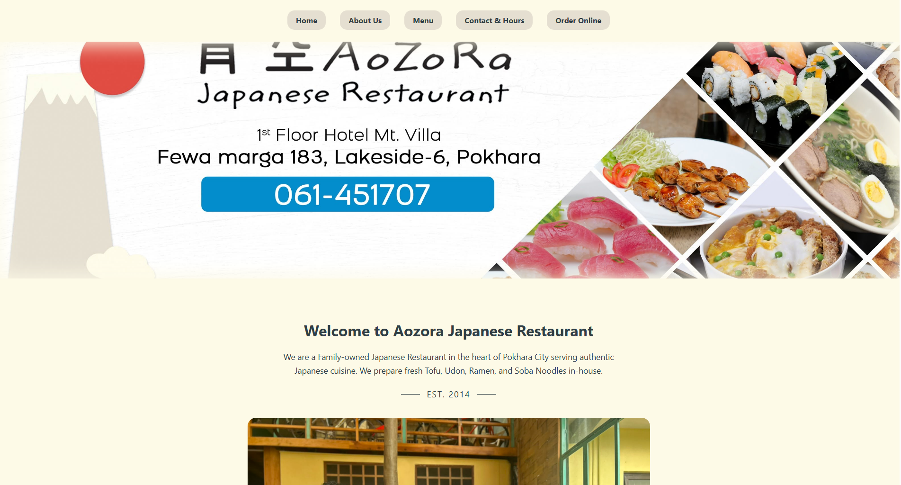
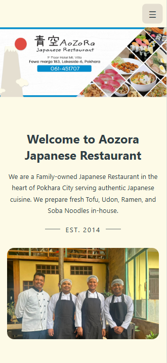
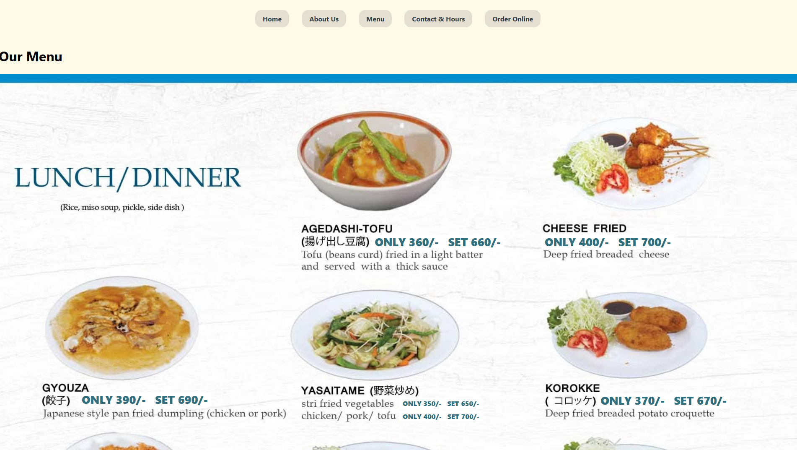

# Aozora Japanese Restaurant

Official website development project for **Aozora Japanese Restaurant**, a family-owned Japanese restaurant established in 2014 in Lakeside-6, Pokhara, Nepal.

This is an ongoing, real-world software engineering project focused on designing, developing, deploying, and maintaining the restaurant's website and future digital services.

**Development Started:** August 2026  
**Current Version:** 1.x — Static Website  
**Status:** Deployed for testing and development  
**Developers:** Nirmal Moktan and Binita Shrestha  
**Hosting:** Cloudflare Pages

### Live Website

**https://aozora-restaurant.pages.dev/**

The current website is deployed for development and testing. The official customer launch is planned after the next major redesign.

---

## Version 1 — Static Website

The first version of Aozora's website was developed using HTML5, CSS3, and JavaScript.

It establishes the restaurant's online presence and serves as the foundation for future full-stack development.

### Features

- Restaurant homepage with branding, introduction, and business information.
- Responsive navigation with a hamburger menu for mobile devices.
- Homepage banner optimized for desktop and mobile screens.
- Automatically scrolling food photography gallery.
- Digital menu displaying 10 pages of Japanese dishes and drinks.
- HTML/CSS price overlays allowing price updates without modifying original menu photographs.
- Restaurant location, contact information, and operating hours.
- Google Maps integration for directions.
- Facebook link for restaurant updates.
- Link to the restaurant's existing third-party online ordering service.
- Automatic deployment to Cloudflare Pages through GitHub integration.

## Screenshots

The following screenshots document the original HTML/CSS website before migration to the modern full-stack architecture.

### Desktop Homepage



### Mobile Homepage



### Digital Menu



These screenshots are preserved to document the website's development history and demonstrate improvements across future versions.

---

## Technologies Used

### Version 1

- **HTML5** — Website structure and content.
- **CSS3** — Layout, styling, animations, and responsive design.
- **JavaScript** — Interactive mobile navigation.
- **Git** — Source control and version history.
- **GitHub** — Repository hosting and developer collaboration.
- **Cloudflare Pages** — Website hosting and automated deployment.
- **Visual Studio Code** — Development environment.

## Project Structure

```text
Aozora/
├── docs/
│   └── screenshots/
│       └── v1/
│           ├── desktop-home.png
│           ├── mobile-home.png
│           └── desktop-menu.png
├── img/
│   └── Restaurant images and menu photographs
├── index.html
├── menu.html
├── styles.css
├── script.js
└── README.md
```

## Running Locally

1. Clone the repository from GitHub.
2. Open the project folder in Visual Studio Code.
3. Open `index.html` in your web browser.
4. Navigate to the menu and other sections using the website navigation.

Version 1 does not require package installation, a backend server, or a database.

---

## Deployment

Version 1 is hosted on **Cloudflare Pages** and connected to the GitHub repository.

The deployment process follows this workflow:

1. Developers make changes locally.
2. Changes are committed and pushed to GitHub.
3. Cloudflare automatically detects changes to the `main` branch.
4. Cloudflare deploys the updated static website.

The website currently uses a temporary `.pages.dev` domain. A custom restaurant domain will be connected after registration and DNS configuration are complete.

---

## Development Roadmap

### Version 2 — Modern Frontend

The next major version will replace the original HTML/CSS website with a modern, mobile-first frontend.

**Planned Technologies:**
- Next.js
- React
- TypeScript
- Tailwind CSS

**Planned Features:**
- Fully responsive restaurant website.
- Reusable React components.
- Redesigned homepage and navigation.
- Category-based digital menu.
- Searchable menu items.
- Menu cards displaying dish names, descriptions, and prices.
- Optional food photography.
- Improved accessibility and search engine optimization.
- Automated frontend testing.

The digital menu will use structured data rather than positioning prices over photographs of printed menus.

### Version 3 — Full-Stack Application

The following phase will introduce backend functionality, persistent data storage, and restaurant management features.

**Planned Technologies:**
- Node.js
- Express.js
- TypeScript
- PostgreSQL
- Neon
- Prisma
- Zod
- GitHub Actions
- Vitest and Playwright

**Planned Features:**
- REST API for restaurant data.
- Secure staff authentication.
- PostgreSQL database integration.
- Administrative dashboard.
- Editable menu items, prices, and availability.
- Restaurant announcement management.
- Customer feedback collection.
- Business analytics and reporting.
- Automated testing and CI/CD pipelines.

### Future Development

Potential future functionality includes:

- Online table reservations.
- Pickup ordering.
- Reservation and order management for restaurant staff.
- Customer feedback analysis.
- Website traffic and engagement analytics.
- Business performance dashboards.
- Monitoring, database backups, security updates, and ongoing maintenance.

Future features will be prioritized based on the restaurant's operational needs and customer feedback.

---

## Collaboration and Version Control

This application is collaboratively developed and maintained by **Nirmal Moktan and Binita Shrestha**.

Development uses a shared GitHub repository with both developers contributing to the same codebase.

Our development workflow includes:

- Git commits to document changes.
- Feature branches for new functionality.
- Pull requests and code reviews as the project evolves.
- Version tags to preserve major releases.
- Automated deployments through Cloudflare Pages.

Major versions and screenshots will be preserved to document the project's technical evolution.

## Long-Term Goals

The goal is to build and maintain a reliable, accessible, and scalable full-stack application serving Aozora Japanese Restaurant and its customers.

The project will evolve from an informational website into a system supporting restaurant operations, customer interactions, and data-driven business decisions.

Development will focus on:

- Real-world software engineering practices.
- Maintainable and reusable code.
- Mobile-first user experience.
- Security and application reliability.
- Automated testing and deployment.
- Measurable improvements in website performance and customer engagement.
- Long-term maintainability.

---

© 2026 Aozora Japanese Restaurant. All rights reserved.